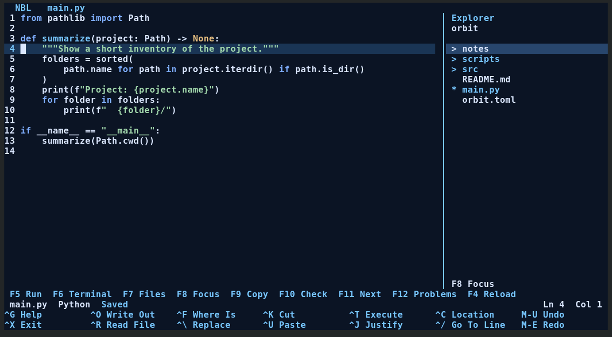
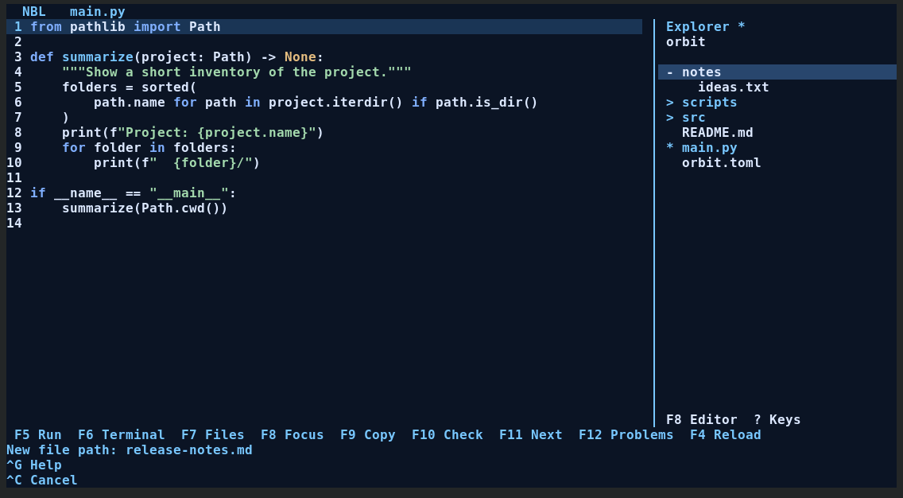
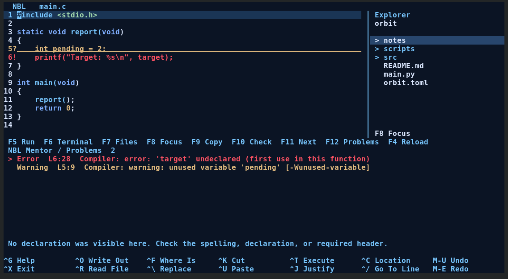
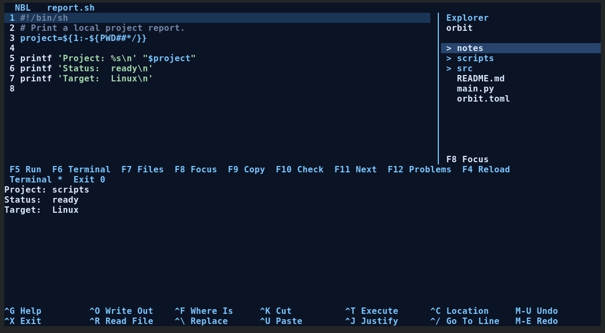
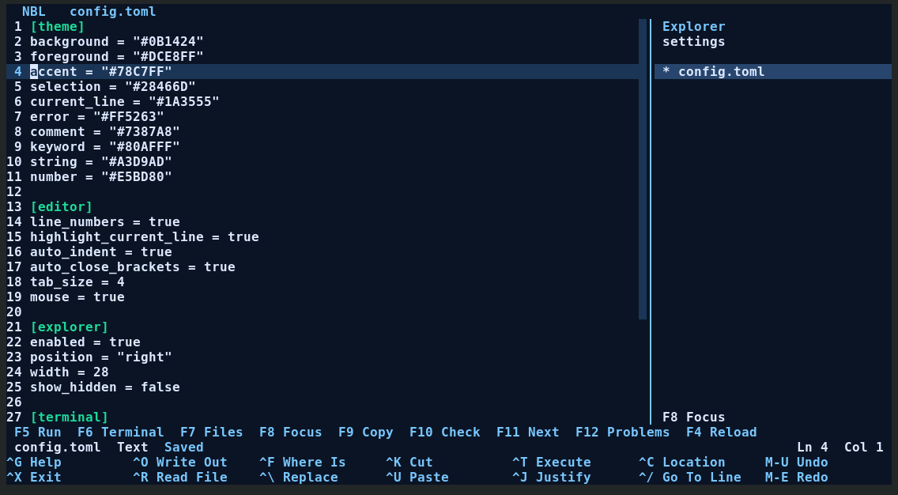

# NBL

**Nano, Beyond Limits.**


NBL is a terminal code editor forked from GNU nano 9.3. It keeps nano’s editing
commands and adds a project tree, local code diagnostics, a terminal for
running the current buffer, and a configurable dark-blue interface.



## Features

- **NBL Mentor** checks POSIX sh, Bash, Python, C, and C++ locally. Errors
  appear in red, warnings in yellow. The bottom pane shows tool messages,
  short explanations, and locations you can jump to.
- **Explorer** opens folders as projects, browses nested directories, toggles
  hidden files, and creates, renames, moves, copies, and deletes entries.
  Open files in separate buffers and switch between them with nano shortcuts.
- **Run and edit** with syntax highlighting, tracked bracket and quote
  pairs, mouse selection, and a pseudoterminal that accepts interactive input.
- **TOML configuration** controls the palette, editing behavior, layout, and
  checker and runner commands. The status line shows the file, language,
  cursor position, and save state.

## Screenshots

| Explorer | NBL Mentor |
| --- | --- |
|  |  |

| Shell script and terminal | TOML configuration |
| --- | --- |
|  |  |

## Installation

Download and extract the release source archive, then run the installer
from that directory. See [BUILDING.md](BUILDING.md) for build dependencies,
the pinned upstream archive, manual build commands, and the Arch package.

```sh
./install.sh --user
"$HOME/.local/bin/nbl" --version
```

The user install puts the binary in `~/.local/bin` and resources in
`~/.local/share/nbl`. It creates a missing
`${XDG_CONFIG_HOME:-$HOME/.config}/nbl/config.toml`. For a custom install,
pass `--prefix /absolute/path` to both scripts.

```sh
sudo ./install.sh --system
./uninstall.sh --user
sudo ./uninstall.sh --system
```

System mode uses `/usr/local`. Each user gets a configuration on their first
launch. Reinstall with the same prefix to update. Uninstall uses the install
manifest to preserve edited files, unrelated files, and user configuration.

The source installer builds for the local GNU/Linux system. The editor and
installer were tested on x86-64 CachyOS, and the Arch package targets baseline
x86-64. Other GNU/Linux distributions and architectures require a local build
with the dependencies listed in [BUILDING.md](BUILDING.md).

## Keyboard shortcuts

| Shortcut | Action |
| --- | --- |
| Ctrl+O / Ctrl+X | Save / close the current buffer, prompting if modified |
| Ctrl+W / Alt+W | Search / repeat search |
| Ctrl+K / Ctrl+U | Cut / paste from the editor cutbuffer |
| Alt+U / Alt+E | Undo / redo |
| Alt+, / Alt+. | Switch to the previous / next open buffer |
| Shift+arrows or mouse drag, then F9 | Select and copy to the cutbuffer and terminal clipboard |
| F4 | Reload TOML configuration |
| F5 / F6 | Run the current code buffer / show or hide its terminal |
| F7 / F8 | Show or hide Explorer / switch focus between the editor and open pane |
| F10 / F11 / F12 | Check with Mentor / jump to the next diagnostic / toggle Problems |
| Ctrl+] | Complete a shell token or use nano’s word completion |

The toolbar also accepts clicks. Clipboard writes depend on terminal
support for OSC 52. In Konsole, Shift+drag selects terminal screen text
for Ctrl+Shift+C.

### Explorer

Start with `nbl ./project` or open a file with `nbl ./project/main.py`. In
Explorer, use the arrow keys, Enter, or the mouse to navigate. Press `?`
for the pane’s shortcuts.

| Key | Explorer action |
| --- | --- |
| Enter / Left / Right | Open or toggle an entry / collapse / expand |
| `g` / `i` / `u` / `h` | Go to a path / enter selected folder / go up / go home |
| `n` / `N` | Create and open a file / create a folder |
| `e` / `m` / `c` / `d` | Rename / move / copy a regular file / confirm deletion |
| `r` / `.` / `-` / `+` | Refresh / toggle hidden entries / resize |

Paths may be absolute or relative. New files and folders start in the selected
directory, or beside the selected file. Relative moves and copies start at
the project root. New parents require confirmation and existing destinations
are protected. Close any affected buffers before moving, renaming, or deleting
an entry. Directory deletion applies to empty directories. Move requires a
shared filesystem. Explorer expands directories in batches using **Load more**.
Links stay outside recursive traversal. The pane hides on narrow terminals.

### Mentor and the terminal

Mentor’s Normal mode checks on open and save. F10 checks the current text,
F12 opens the diagnostic list, and Enter jumps to the selected location.
Mentor uses `sh -n`, `bash -n`, optional ShellCheck, Python’s syntax compiler,
or the configured C/C++ compiler’s syntax-only mode. Source stays local.
Checks have time and output limits. Use `unset checkonopen` or
`unset checkonsave` in your `nblrc` to control automatic checks.

F5 explicitly runs the current text, including unsaved edits, in the file’s
directory. Ctrl+C interrupts the foreground program. The terminal displays
its live screen. For multi-file C or C++ projects, use the project’s build
command in your shell. F5 compiles a single translation unit.

## Configuration

NBL reads [the TOML template](config.toml.example) from
`${XDG_CONFIG_HOME:-$HOME/.config}/nbl/config.toml`. Check it with
`nbl --check-config` and reload it with F4. These settings override their
counterparts in [nblrc](nblrc.example).

```toml
[theme]
background = "#0B1424"
accent = "#78C7FF"

[editor]
line_numbers = true
auto_close_brackets = true
tab_size = 4

[explorer]
position = "right"
width = 28

[terminal]
height = 12

[tools]
python = "python3"
cc = "gcc"
cxx = "g++"
```

## Roadmap

- Completion chooser for shell and project paths.
- Project compiler flags and diagnostics from additional toolchains.
- Terminal scrollback and compatibility testing across more GNU/Linux systems.

## Credits

NBL is an independent fork of [GNU nano](https://www.nano-editor.org/), originally
written by Chris Allegretta and maintained by the GNU nano contributors.
The editor is licensed under [GPL-3.0-or-later](LICENSE).
[UPSTREAM.md](UPSTREAM.md) documents the pinned version, upstream copyrights,
and the bundled libvterm and tomlc17 libraries.
